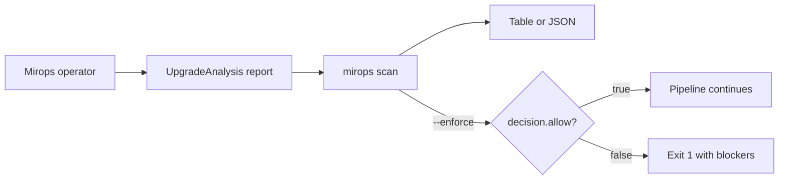

# Mirops CLI

Read a Mirops upgrade-analysis report and turn it into a clear decision for people and CI/CD pipelines. The CLI can print a table or JSON and optionally fail a pipeline when the operator’s report blocks an upgrade.

The CLI reads reports produced by the Mirops Kubernetes operator; it does not recompute the decision from the readiness score.



## Capabilities

- Read a report from a local path, `file://`, `http://`, `https://`, `s3://`, or `azure://` source.
- Render the operator’s `SAFE`, `WARNING`, or `CRITICAL` decision.
- Emit a readable table or JSON.
- Enforce the decision with a configurable severity threshold.
- Configure common options with `MIROPS_*` environment variables.

## Install or build

Requires Go 1.26.2 or newer to build from source.

```sh
go build -o bin/mirops .
```

You can also run it directly from the checkout:

```sh
go run . scan --source ./report.mirops
```

## Common workflows

```sh
# Read a local report.
mirops scan --source ./report.mirops

# Read from file, HTTP, or a cloud object store.
mirops scan --source file:///tmp/report.mirops
mirops scan --source https://reports.example.org/upgrade.mirops

# Produce JSON for another tool.
mirops scan --source ./report.mirops --output json

# Fail on a blocked upgrade (CRITICAL).
mirops scan --source ./report.mirops --enforce

# Also fail on WARNING for a stricter pipeline.
mirops scan --source ./report.mirops --enforce --enforce-level warning
```

## Command reference

```text
mirops scan [flags]
```

| Flag | Environment variable | Description |
| --- | --- | --- |
| `--source` | `MIROPS_SOURCE` | Report source: path, `file://`, `s3://`, `azure://`, `http://`, or `https://`. |
| `--enforce` | `MIROPS_ENFORCE` | Exit with code 1 according to the report’s decision. |
| `--enforce-level` | `MIROPS_ENFORCE_LEVEL` | Minimum failing level: `critical` (default) or `warning`. |
| `--target-version` | `MIROPS_TARGET_VERSION` | Expected target version. |
| `--output` | `MIROPS_OUTPUT` | Output format: `table` or `json`. |
| `--timeout` | `MIROPS_TIMEOUT` | Request timeout duration. |
| `--retry` | `MIROPS_RETRY` | Number of retries on failure. |

The `--api-url`, `--api-token`, and `--cluster` flags (and corresponding environment variables) are reserved for SaaS mode and are not implemented in this open-source CLI.

## How enforcement works

The operator computes the verdict from deterministic report facts, such as incompatible add-ons, lost PVCs, PodDisruptionBudgets, CPU or memory pressure, and pods not ready. The CLI trusts that verdict; it does not turn `scores.total` into a gate.

| Result | `decision.allow` | Pipeline meaning |
| --- | --- | --- |
| `SAFE` | `true` | No blocker was found. |
| `WARNING` | `true` | Issues need attention, but the upgrade is not blocked. |
| `CRITICAL` | `false` | Fix the listed blockers before upgrading. |

By default, `--enforce` fails on CRITICAL. Set `--enforce-level warning` to fail on WARNING as well.

## Develop and contribute

```sh
go test ./...
go fmt ./...
```

The CLI is part of the open Mirops ecosystem. See the Apache-2.0 [LICENSE](LICENSE) and contribute a focused change that keeps the command behavior and documentation aligned.

