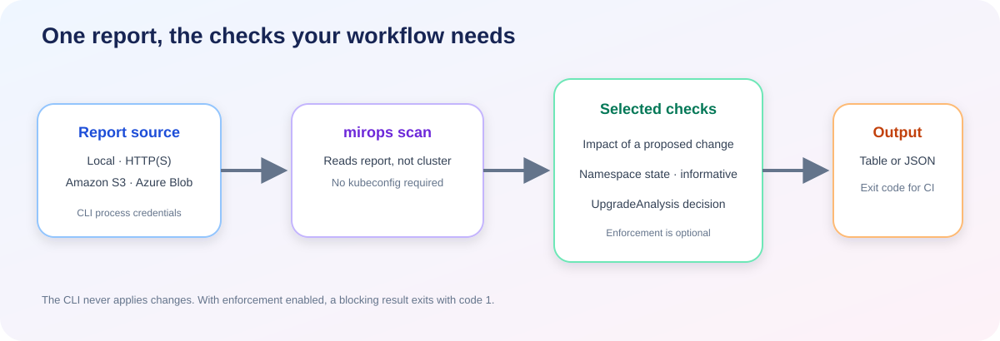
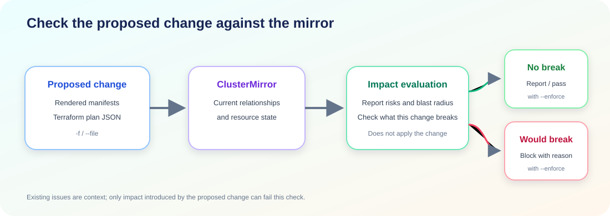
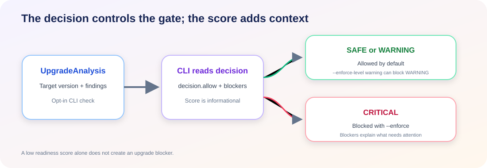

# Mirops CLI

The `mirops-cli` is the pipeline gate for [Mirops](https://github.com/miropshq/mirops). It reads the Cluster Mirror report the Mirops operator publishes and answers, before you deploy, whether the change would break something running — and, when upgrade analysis is on, whether the cluster is ready for the next Kubernetes version. For upgrades it trusts the operator's deterministic decision; it never makes a gate from the readiness score.

## What it checks

| Check | Input | What it answers | Can block? |
| --- | --- | --- | --- |
| Impact of a change | `-f` / `MIROPS_FILE` | Does a manifest or Terraform plan break something in the cluster mirror? | Yes, with `--enforce` |
| Namespace state | `-n` / `MIROPS_NAMESPACE` | What is at risk in selected namespaces, and what depends on it? | No |
| Upgrade readiness | `--upgrade` / `MIROPS_UPGRADE` | Does the UpgradeAnalysis report allow the target Kubernetes upgrade? | Yes, with `--enforce` |

The CLI reads the mirror report, not the live cluster, so it adds no load to the Kubernetes API server. Reports can come from a local file, HTTP(S), Amazon S3, or Azure Blob Storage — with the report in S3 or Azure Blob, a pipeline needs no kubeconfig.



## Install

Download the release binary for your platform from the [latest release](https://github.com/miropshq/mirops-cli/releases/latest), make it executable, and place it on your `PATH`. No `sudo` is required.

For example, on macOS with Apple Silicon:

```sh
curl -fsSLO https://github.com/miropshq/mirops-cli/releases/latest/download/mirops-darwin-arm64
mkdir -p "$HOME/.local/bin"
install mirops-darwin-arm64 "$HOME/.local/bin/mirops"
mirops --version
```

| Platform | Binary |
| --- | --- |
| macOS (Apple Silicon) | `mirops-darwin-arm64` |
| macOS (Intel) | `mirops-darwin-amd64` |
| Linux (x86_64) | `mirops-linux-amd64` |
| Linux (arm64) | `mirops-linux-arm64` |
| Windows (x86_64) | `mirops-windows-amd64.exe` |

Pin a version in CI by replacing `releases/latest` in the download URL with a version tag, such as `releases/download/v0.3.0`.

Betas are published from the `beta` branch as pre-releases tagged `vX.Y.Z-beta.N`, and never become `latest`; a stable release follows when `beta` is merged into `main` — see [How releases work](CONTRIBUTING.md#how-releases-work). Download one by its tag, for example `releases/download/v0.3.0-beta.1/mirops-linux-amd64`.

To verify a download:

```sh
curl -fsSL -O https://github.com/miropshq/mirops-cli/releases/latest/download/checksums.txt
shasum -a 256 --check --ignore-missing checksums.txt   # macOS
sha256sum --check --ignore-missing checksums.txt        # Linux
```

## Common workflows

Point `MIROPS_SOURCE` (`--source`) at the ClusterMirror report, then choose the checks with the inputs you give. At least one is needed — with none, `mirops scan` exits `2` (*nothing to scan*):

```sh
# Impact of a change: blocks the deploy when it would break something running
mirops scan --source ./default.mirops --file k8s/ --namespace payments --enforce
helm template payments ./chart | mirops scan --source ./default.mirops --file - --enforce
terraform show -json plan.out | mirops scan --source ./default.mirops --file - --enforce

# Namespaces' state (informational, never blocks)
mirops scan --source ./default.mirops --namespace payments,orders

# Upgrade gate on an UpgradeAnalysis report (opt-in)
mirops scan --source ./default.mirops --upgrade --upgrade-source ./to-1-35.mirops --enforce

# The same, but also block on WARNING
mirops scan --source ./default.mirops --upgrade --upgrade-source ./to-1-35.mirops --enforce --enforce-level warning

# JSON instead of the table, for another tool
mirops scan --source ./default.mirops --namespace payments --output json
```

In a pipeline, set the same values as `MIROPS_*` environment variables and run `mirops scan`.

### Impact of a change

Use `-f` / `--file` with rendered YAML or JSON, a directory of manifests, standard input (`-`), or a Terraform plan in JSON produced by `terraform show -json`. With `--enforce`, the impact check blocks changes that delete resources still in use, mount a Pending, Lost, or missing volume, route an Ingress to a missing Service, or depend on something deleted by the same change.

The check reports existing problems and the blast radius as context; it blocks only on what the proposed change breaks. It does not accept source files that need rendering first, such as Helm values, Kustomize configuration, Terraform source files, templates, or binary plans. Render those to YAML or JSON before scanning.



### Namespace state

Set `-n` / `--namespace` to one namespace, a comma-separated list, or `all`. This check reports at-risk components and their dependents, but never blocks a pipeline. When used with `-f`, it limits impact evaluation to the named namespaces.

### Upgrade readiness

Upgrade analysis is opt-in for the CLI. Set `MIROPS_UPGRADE=true` (or pass `--upgrade`) and provide the UpgradeAnalysis report with `MIROPS_UPGRADE_SOURCE` (or `--upgrade-source`). The target version comes from that report. If the cluster already runs the target version, the check is skipped successfully.

```yaml
env:
  MIROPS_SOURCE: s3://mirops-reports/prod/default.mirops
  MIROPS_UPGRADE: "true"
  MIROPS_UPGRADE_SOURCE: s3://mirops-reports/prod/to-1-35.mirops
  MIROPS_ENFORCE: "true"
steps:
  - run: mirops scan
  - run: terraform apply
```

The operator must have upgrade analysis enabled when installed. The CLI reads each report using the credentials configured in its environment for that source.

## Decision and exit codes

The operator calculates the decision from deterministic facts, including incompatible add-ons, lost PVCs, blocking PodDisruptionBudgets, CPU or memory pressure, and pods not ready. The CLI renders that decision; the health score is a gauge, not the gate.

| Decision | `decision.allow` | Meaning |
| --- | --- | --- |
| `SAFE` | `true` | No upgrade blocker was found. |
| `WARNING` | `true` | Issues need attention, but the upgrade is allowed. |
| `CRITICAL` | `false` | Resolve the listed blockers before upgrading. |

| Exit code | Meaning |
| --- | --- |
| `0` | Passed, or no upgrade check was needed. |
| `1` | A check blocked and enforcement is enabled. |
| `2` | The CLI could not evaluate the request, such as a missing or unreadable report, invalid option, or unsupported unrendered input. |



## Command reference

```text
mirops scan [flags]
```

| Flag | Environment variable | Description |
| --- | --- | --- |
| `--source` | `MIROPS_SOURCE` | ClusterMirror report source: path, `file://`, `s3://`, `azure://`, `http://`, or `https://`. |
| `--upgrade` | `MIROPS_UPGRADE` | Run the upgrade check. |
| `--upgrade-source` | `MIROPS_UPGRADE_SOURCE` | UpgradeAnalysis report source. |
| `-n`, `--namespace` | `MIROPS_NAMESPACE` | Namespace, comma-separated namespaces, or `all`. |
| `-f`, `--file` | `MIROPS_FILE` | Rendered manifests, directory, stdin, or Terraform plan JSON. |
| `--max-mirror-age` | `MIROPS_MAX_MIRROR_AGE` | Maximum age for a mirror report (default `1h`). |
| `--enforce` | `MIROPS_ENFORCE` | Exit with code 1 when a check blocks. |
| `--enforce-level` | `MIROPS_ENFORCE_LEVEL` | Minimum upgrade decision that blocks: `critical` (default) or `warning`. |
| `--output` | `MIROPS_OUTPUT` | Output format: `table` or `json`. |

Flags override environment variables. Pointing `--source` at an UpgradeAnalysis report instead gates on that analysis directly, as in 0.1.0. SaaS options `--api-url`, `--api-token`, and `--cluster` are reserved and are not implemented in the open-source CLI.

## Credentials

`mirops scan` reads each source with the pipeline's own credentials for its scheme — it has no credential flags:

| Source | Credentials |
| --- | --- |
| `s3://` | The AWS SDK chain: `AWS_ACCESS_KEY_ID` / `AWS_SECRET_ACCESS_KEY` / `AWS_SESSION_TOKEN`, a web identity (`aws-actions/configure-aws-credentials` with a role, IRSA), `AWS_PROFILE`, or the machine's role. Set `AWS_REGION` to the bucket's region. Needs only `s3:GetObject` on the report. |
| `azure://` | `DefaultAzureCredential`: `AZURE_CLIENT_ID` / `AZURE_TENANT_ID` / `AZURE_CLIENT_SECRET`, workload identity, or managed identity. Needs read access to the blob. |
| `http(s)://` | None — e.g. the operator's reports service, `http://mirops-reports.mirops:8084/reports/<name>.mirops?kind=ClusterMirror`, from inside the cluster. |

## Build from source

Requires Go 1.26.2 or newer.

```sh
go build -o bin/mirops .
go test ./...
go fmt ./...
```

## License

Apache-2.0. See [LICENSE](LICENSE).
