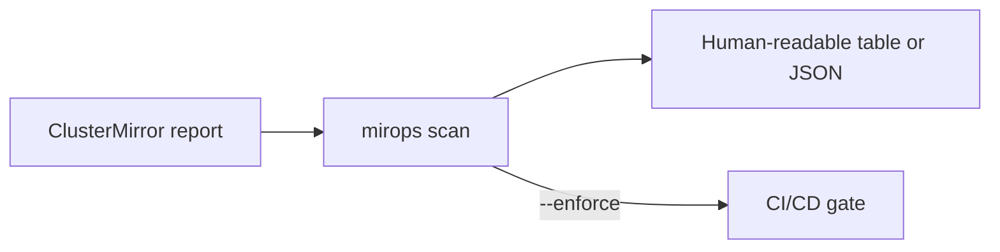

# Mirops CLI

Turn a Mirops report into a clear command-line answer for people and pipelines. The CLI renders mirror state, evaluates change impact when requested, and enforces the operator’s deterministic upgrade decision.



## Install and run

Requires Go `1.26.2` or newer.

```sh
go build -o bin/mirops .
./bin/mirops scan --source ./report.mirops
```

The source may be a local path, `file://`, `http://`, `https://`, `s3://`, or `azure://` location.

## The workflow

```sh
# Inspect a mirror report.
mirops scan --source s3://reports/prod/default.mirops -n payments

# Evaluate the impact of a manifest, rendered Helm/Kustomize output, or Terraform plan.
mirops scan --source s3://reports/prod/default.mirops -f ./change.yaml

# Enforce an opt-in upgrade-analysis result in CI.
MIROPS_UPGRADE=true \
MIROPS_UPGRADE_SOURCE=s3://reports/prod/to-1-35.mirops \
mirops scan --enforce
```

`--enforce` follows `decision.allow`; it does not turn the readiness score into a gate. `SAFE` and `WARNING` allow the upgrade, while `CRITICAL` returns a non-zero exit status with its blockers.

## Useful options

| Option | Environment fallback | Purpose |
| --- | --- | --- |
| `--source` | `MIROPS_SOURCE` | Mirror report location. |
| `-n` | — | Show a namespace’s current state; informational only. |
| `-f` | — | Evaluate the impact of a change. |
| `--enforce` | `MIROPS_ENFORCE` | Fail the pipeline only when the selected decision blocks it. |
| `--output json` | `MIROPS_OUTPUT` | Produce machine-readable output. |

## Development

```sh
go test ./...
go fmt ./...
```

The CLI is an open-source member of the Mirops ecosystem. See the [operator](https://github.com/miropshq/mirops), [documentation portal](https://github.com/miropshq/mirops-docs), and [LICENSE](LICENSE) for more context.

